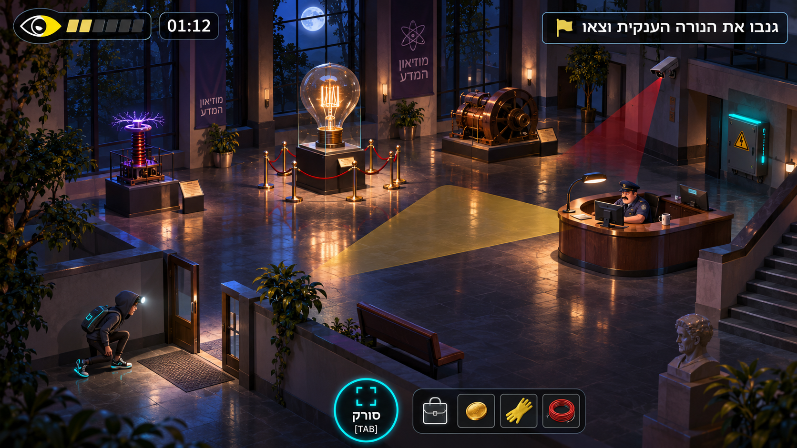
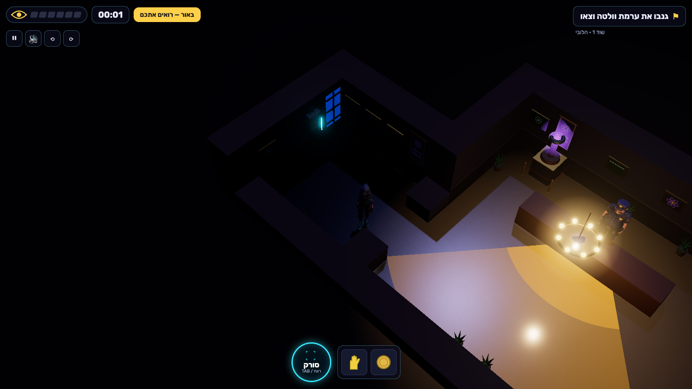
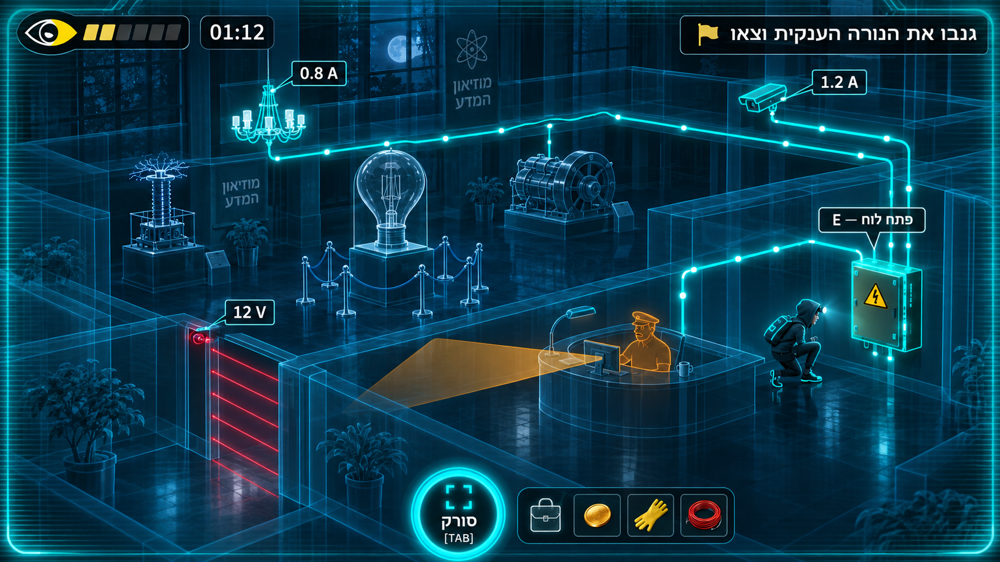
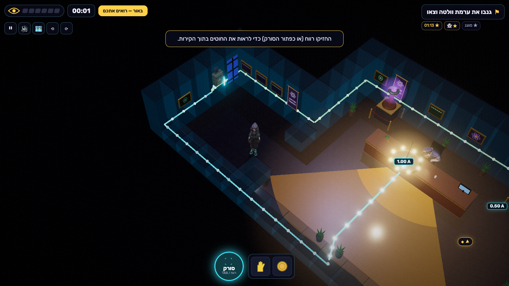
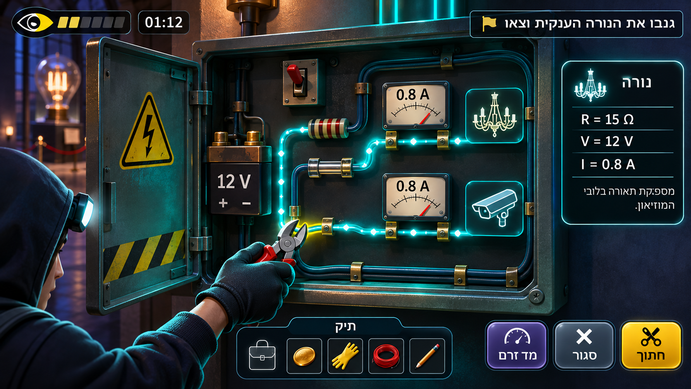
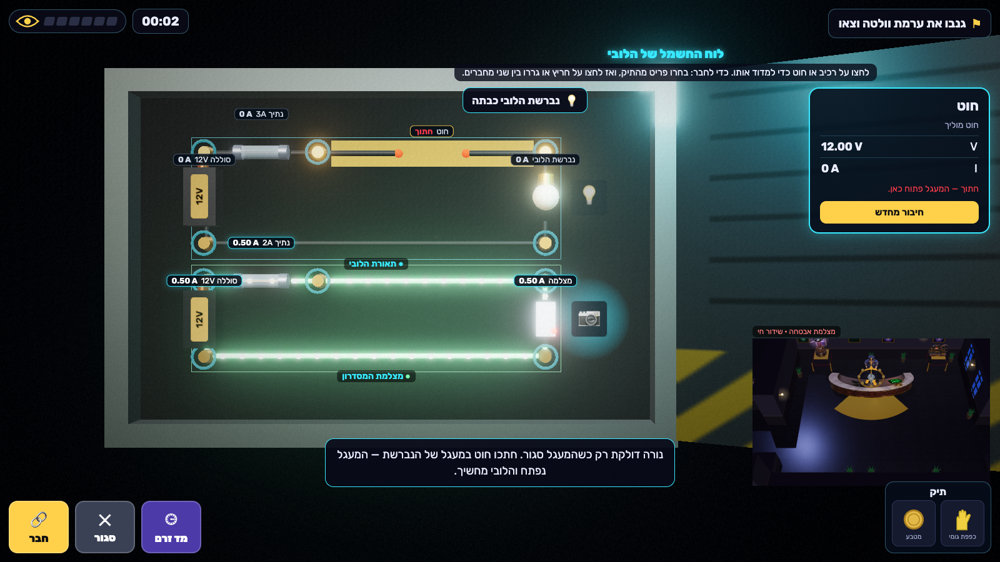
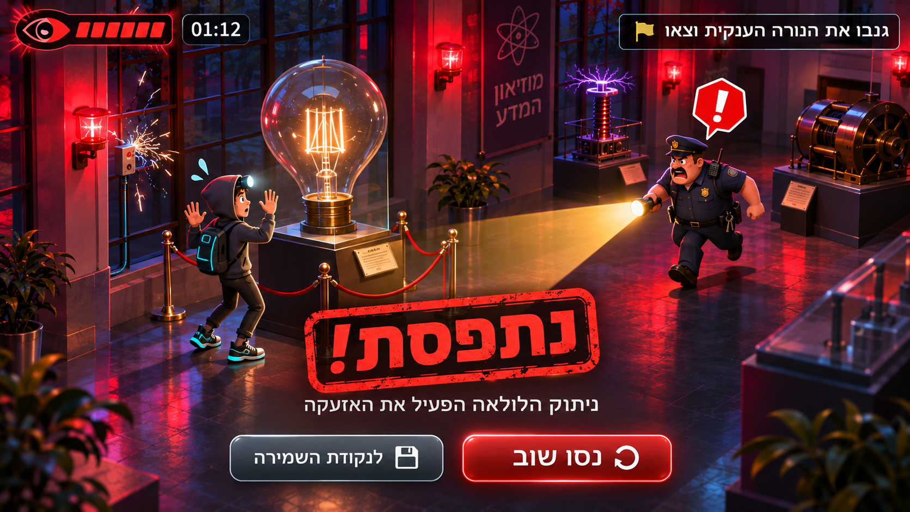
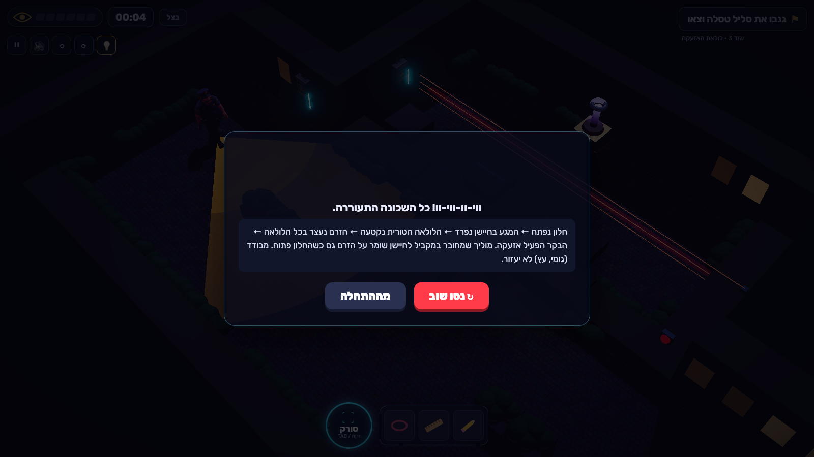

# Visual review — mockups vs the real game

Targets: ChatGPT (gpt-image) mockups in [`visual-targets/`](visual-targets/) (prompts in [`PROMPTS.md`](visual-targets/PROMPTS.md)). They are design targets, never evidence of the game.
Actuals: real captures in [`captures/`](captures/), taken by [`scripts/capture.mjs`](../scripts/capture.mjs) at 1600×900 in headless Chromium (SwiftShader) with real keyboard and mouse events; walking uses the same click-to-move path as a floor click. Captured 25 Oct 2026 after the review fixes.

| Moment | Target | Actual |
|---|---|---|
| First 30 seconds |  |  |
| Scanner X-ray |  |  |
| Panel close-up |  |  |
| Failure |  |  |

Other heists: [2](captures/actual-heist2.png) · [4](captures/actual-heist4.png) · [5](captures/actual-heist5.png) · [6](captures/actual-heist6.png).

## 01 — first 30 seconds

| Aspect | Target | Actual | Verdict |
|---|---|---|---|
| Camera | High isometric 3/4 view, cut-away room, whole lobby visible | Perspective 32° FOV at ~53° elevation, 45° yaw, cut-away walls lowered on the camera side, rotates in 90° steps (Z/X) | Matches. The real camera is a little closer so characters stay readable. |
| Silhouettes | Hooded thief with headlamp + cyan sneakers; chunky guard with cap at a desk | Tripo-generated, Mixamo-rigged thief (hoodie, backpack) and guard (cap, uniform), walk/idle clips playing; guard behind the reception desk | Matches the characters. The guard stands rather than sits (no sitting clip). |
| Lighting | Indigo night, warm pools, moonlit windows | Warm chandelier pool and glow, indigo moon/hemisphere fill, moonlit window panes and sconces as wall decor, bloom | Close. The real scene is darker overall: deliberate, because light = danger has to read at a glance. |
| Guard vision | Translucent yellow wedge | Wall-occluded vision fan (bright near/flashlight part + faint far part), turns red as the guard notices | Matches, and it's gameplay-accurate (raycast against walls). |
| Exhibits | Giant bulb on plinth, Tesla coil, dynamo | Procedural Tesla coil and dynamo on pedestals in the lobby; Tripo giant bulb in heist 2 | Fewer exhibits per room than the mockup. |
| HUD | Eye meter + timer top-left, objective flag top-right, round scanner button + bag tray bottom-centre | Same layout, Hebrew RTL, Rubik bundled; plus a light/shadow chip ("באור — רואים אתכם" / "בצל") | Matches. The light chip is an addition. |

## 02a — scanner

| Aspect | Target | Actual | Verdict |
|---|---|---|---|
| Walls | Dark translucent glass with cyan edges | Walls fade to translucent dark glass; scene light dims | Matches in spirit. The mockup's wireframe edges aren't drawn. |
| Wires | Neon cyan wires inside the walls, current dots | Glowing tubes from the panel to each device in its circuit colour, dots whose speed follows the solved current; dead wires dim and stop | Matches, and the dots are physically driven. Wires run straight through the ceiling layer, so in the iso view some cross rooms diagonally instead of hugging walls. |
| Tags | "0.8 A", "12 V" tags | Live current tag at every device ("1.00 A") | Matches. Voltage tags only show inside the panel. |

## 02b — panel close-up

| Aspect | Target | Actual | Verdict |
|---|---|---|---|
| Board | Steel cabinet, door open with hazard stripe, battery, brass terminals, fuse, wires with glowing current | 3D cabinet (door swings open), batteries with V labels, glass fuses with filaments, brass posts, lamp/camera/motor/sensor/relay meshes, resistors with colour bands, current dots | Matches. |
| Gauges | Analog ammeter dials per branch | Digital amp tags on every component; ammeter mode labels every wire too | Digital tags instead of dials (clearer for comparing values). |
| Inspector | Right card: name, R, V, I, short description | Right card: name, kind, R, V, I, P, status and actions | Matches. |
| Buttons and bag | Bottom: bag tray + מד זרם / סגור / חתוך | Same, plus a live CCTV inset of the building | Matches. The inset is an addition so consequences are visible while the world is paused. |
| Hands | Gloved hand with cutters in the foreground | Not shown | Missing (no first-person hand). |

## 03 — failure

| Aspect | Target | Actual | Verdict |
|---|---|---|---|
| Moment | Alarm: red strobes, guard runs in with flashlight, thief hands up, "!" bubble | Camera pushes in on the thief, hands raised (procedural arm pose layered on the Tripo rig), guard turns with a red "!!" bark, siren lights strobe red, siren sound and a sad trombone | Close. The guard doesn't run in; he turns and points his flashlight. The red strobe is visible between frames, not in every capture. |
| Card | Big rotated red stamp "נתפסת!", reason line, retry/checkpoint buttons | Rotated stamp (נתפסת / אזעקה / צולמת / התחשמלות / קצר…), funny line, a worked explanation of the physics, "נסו שוב / מנקודת השמירה" + "מההתחלה" | Matches, plus the worked explanation (required for learning). |

## Remaining deviations (honest list)

- Rooms carry fewer props than the mockups (no benches, statues or staircases); walls are dressed with procedural paintings, banners, sconces, windows and plants.
- The thief now has Tripo `run`, `afraid` (busted) and `cheer` clips; the desk guard sits (`sit`). There's still no crouch/sneak clip.
- Scanner wires now run inside the walls (routed through wall tiles) and are revealed by an X-ray wave, closer to the mockup than before.
- Captures were rendered with SwiftShader (about 9 fps). On the host GPU every heist runs at the 120 fps cap (`scripts/fps.mjs`).
